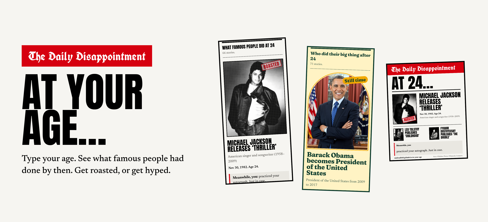
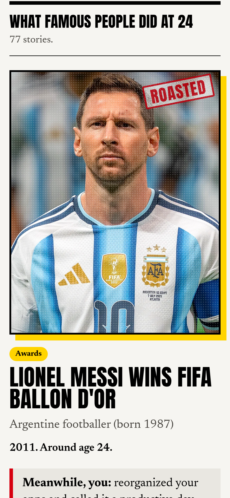
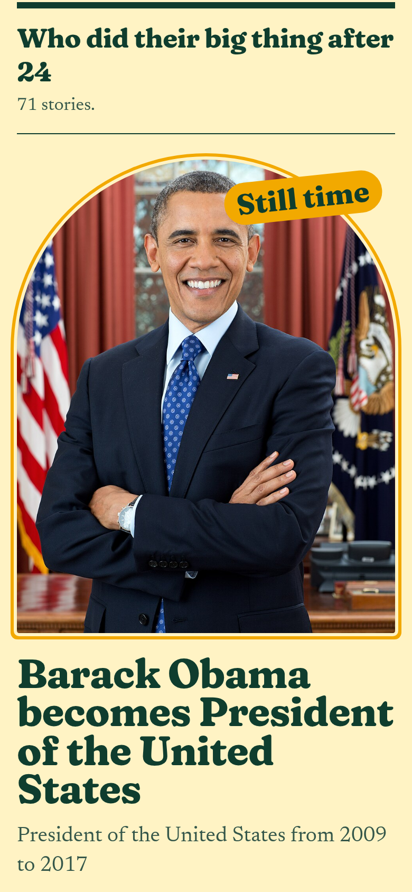
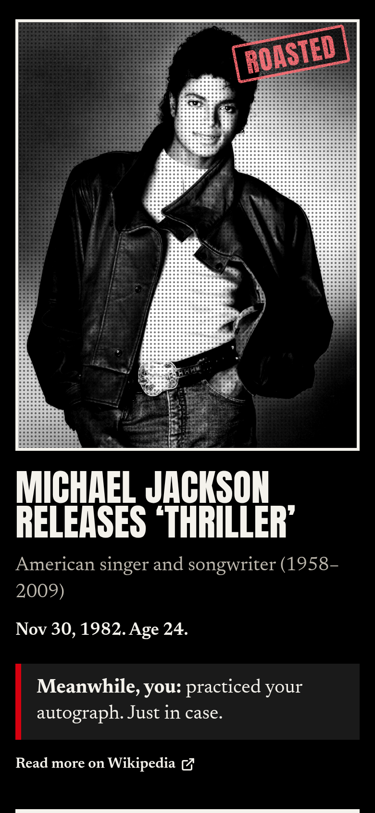
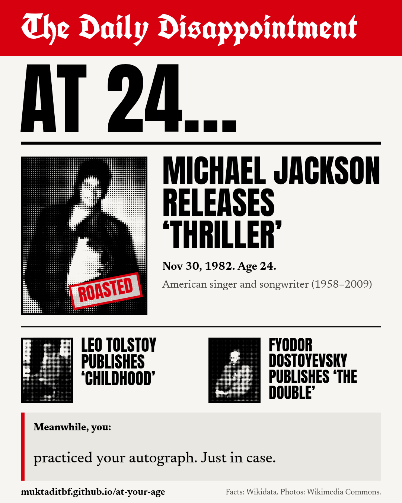
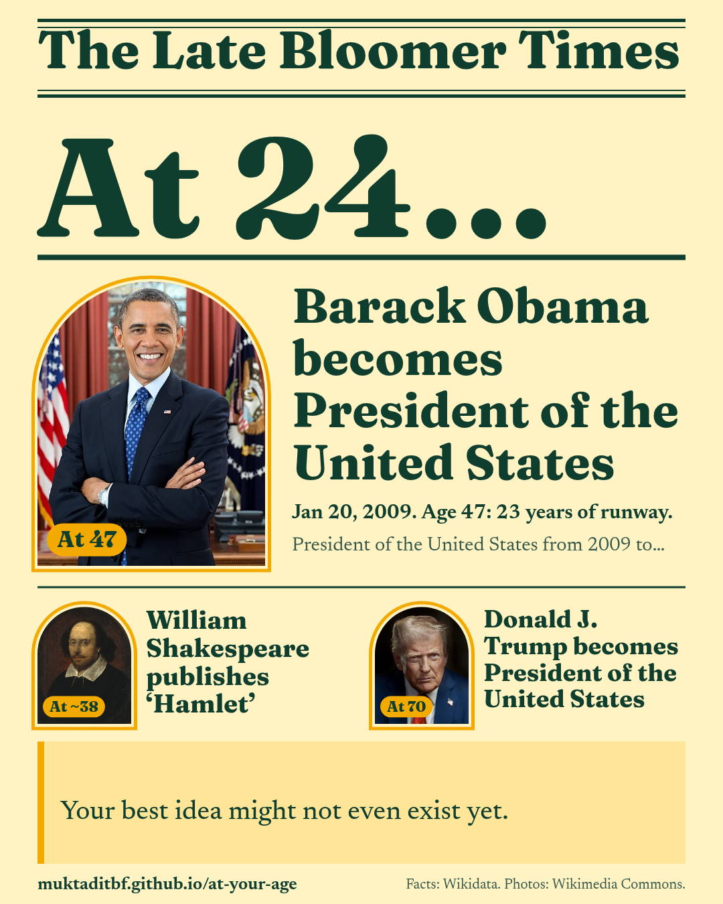

<div align="center">



# At Your Age…

**Type your age. See what famous people had already done by then.**
Get roasted, or get hyped.

[**Open the app →**](https://muktaditbf.github.io/at-your-age/)
&nbsp;·&nbsp; [Report a bug](https://github.com/Muktaditbf/at-your-age/issues/new?template=bug_report.yml)
&nbsp;·&nbsp; [Suggest a line](https://github.com/Muktaditbf/at-your-age/issues/new?template=line.yml)

[](https://github.com/Muktaditbf/at-your-age/actions/workflows/ci.yml)
[](LICENSE)
[](#where-the-facts-come-from)
[](#privacy)
[](https://github.com/Muktaditbf/at-your-age/stargazers)

<sub>If it made you laugh (or cry a little), a ⭐ helps other people find it.</sub>

</div>

---

## What it does

You type an age. The app prints a newspaper front page about it, using live facts from Wikidata.

- **Roast edition, _The Daily Disappointment_:** what famous people did at exactly your age.
  "At 24, Lionel Messi wins the Ballon d'Or. _Meanwhile, you:_ 6 hours of screen time, 0 minutes on
  the thing you said you'd start."
- **Hype edition, _The Late Bloomer Times_:** famous people who did their big thing _later_ than
  your age, and how much runway that gives you.
  "Elon Musk founds SpaceX. Age 30: 6 years of runway. Main character energy. Your episode just
  airs later."

Got roasted? One tap on **Hype me up** flips the paper to the hype edition for the same age. Then
share your front page as an image.

<table>
  <tr>
    <td align="center"><br><sub><b>Roast</b>: what they did at your age</sub></td>
    <td align="center"><br><sub><b>Hype</b>: who did it later than you</sub></td>
    <td align="center"><br><sub><b>Night print</b> follows your system</sub></td>
  </tr>
  <tr>
    <td align="center" colspan="3">
      
      <br>
      <sub><b>Share your front page</b>: made on your device, sent through your phone's share menu</sub>
    </td>
  </tr>
</table>

## Features

- 🗞️ **Two editions of one paper.** A red-top tabloid for roasts and a sunny paper for hype.
  Switching flips the whole page over.
- 🌱 **Hype me up.** After a roast, a card (and a pill that follows you down the page) takes you
  to the hype edition for the same age, with a burst of petals.
- 📏 **Age ruler.** Swipe a measuring tape of years, or type over "your age" in the headline. The
  digits roll like an odometer, and the button says "Roast me at 30" until you ask again.
- 🔥 **Popular people first.** Stories are ranked by how much people read about them on Wikipedia
  this month, so you get Messi and Michael Jackson before medieval kings.
- 🎨 **Colourful pages.** Full-colour photos with a pop-colour frame per newsroom desk
  (music & film, awards, crowns & offices, business, science).
- 📰 **Breaking-news ticker** running your front page's headlines; it slows down under the
  pointer so you can read it.
- 📡 **Always live.** Every search asks Wikidata fresh. Nothing is cached, so new facts show up as
  soon as volunteers add them.
- ⏳ **Fun while you wait.** "Stop the presses!" types out what the newsroom is doing and shows which
  of the five desks has answered. The first stories usually show up within about 4 seconds.
- 🧾 **Honest ages.** When Wikidata only knows the year, the paper says "around age 24" instead
  of pretending. Every story links to its source.
- 📤 **Share card.** A 1080×1350 image (pop-colour frames for roasts, arches for hype) shared
  through your phone's share menu, or downloaded.
- 🔗 **Links that work.** `?age=24&mode=hype` opens that front page directly, and Back goes back.
  Shared links show a proper title and preview image.
- ♿ **Accessible.** Works with a keyboard and screen readers (the ruler is a real slider), respects
  reduced motion, and is checked with axe in both editions, by day and by night.

## Where the facts come from

1. **Five searches per age**, one per newsroom desk:

   | Desk | Wikidata fact |
   | --- | --- |
   | Books, films and music | notable work (P800) and its publication date |
   | Awards | award received (P166) and when |
   | Crowns and offices | position held (P39) and its start, for offices tied to a place |
   | Companies and bands | founded by (P112) and inception |
   | Discoveries and inventions | discoverer or inventor (P61) and when |

2. They run on **[QLever](https://qlever.dev/wikidata)**, a fast public search engine for Wikidata
   from the University of Freiburg. The official Wikidata endpoint needed 17–47 seconds for these
   questions; QLever answers in about 3–6. At most three searches run at once, and if the server
   says "slow down", the app waits and asks again.
3. **Photos, one-line bios and popularity** come from English Wikipedia, 50 people per request:
   page views over the last 30 days decide the order, so people readers care about now come first.
4. To be found at all, a person (and the thing they did) needs articles in many Wikipedia language
   editions. The hype edition asks for a bit more fame.
5. The lead story is the most popular one, except politics: offices stay in the list below, so a
   sitting president is never the "Roasted" or "Still time" hero.

**Honesty rules:**

- Ages come from the birth date and the date of the deed. If either date is only known to the year
  (or to the month, in the birth month), the age is shown as "around".
- Nothing dated after someone's death counts, so no posthumous albums.
- Some people are never shown: perpetrators of genocide and mass murder, terrorists, serial killers
  and notorious abusers, plus founders of religions and prophets, whom many readers hold sacred.
  The list is in [`src/data/blocklist.ts`](src/data/blocklist.ts) and `npm run probe -- --blocklist`
  checks it against Wikidata.
- Wikidata is written by volunteers, so now and then a date is wrong. Every story links to its
  Wikipedia article.

## Privacy

- No accounts, no cookies, no analytics. Fonts are bundled.
- The only things sent anywhere: the age you type (inside the search sent to QLever) and the names
  in your results (to Wikipedia, for photos).
- Just opening the home page contacts no one. Connections start when you tap the age box or open
  a link that already has an age.
- The share image is drawn in your browser. It never leaves your device unless you share it.

## Built with

- **React 19**, **TypeScript** (strict) and **Vite 8**
- **Tailwind CSS v4** with two editions × two prints of design tokens
- **SPARQL** on [QLever](https://qlever.dev/wikidata), plus the Wikipedia API
- **[Motion](https://motion.dev)** (free) for the animations: rolling digits, the ticker, card
  layout animations, the stamp, the petals; its features load after the first paint
- **Canvas** for the share card
- **zod** (mini) to check every answer from the servers
- **Vitest** unit tests and **Playwright** end-to-end tests on phone and desktop sizes, against
  recorded real answers, including failure and retry paths and **axe** accessibility checks
- **GitHub Actions** for CI and **GitHub Pages** for hosting

```
src/
├── lib/sparql.ts      # the five searches, as SPARQL
├── lib/qlever.ts      # fetch with timeouts, retries and at most 3 at a time
├── lib/dates.ts       # Wikidata dates and honest age math ("around")
├── lib/stories.ts     # rows → one story per person
├── lib/headline.ts    # "Michael Jackson releases ‘Thriller’"
├── lib/wikipedia.ts   # photos and one-line bios
├── lib/lines.ts       # everything the paper says that isn't a fact ← PRs welcome!
├── lib/ruler.ts       # the age ruler's math
├── lib/shareCard.ts   # the shareable front page, drawn on a canvas
├── lib/edition.ts     # runs one edition: searches, progress, retries
├── data/blocklist.ts  # people the paper leaves out
└── components/        # masthead, ticker, age form + ruler, stories, comeback, sharing
```

## Run it locally

```bash
git clone https://github.com/Muktaditbf/at-your-age.git
cd at-your-age
npm install
npm run dev
```

| Command | What it does |
| --- | --- |
| `npm run dev` | Start the dev server |
| `npm test` | Unit tests (Vitest) |
| `npm run e2e` | End-to-end tests against recorded answers (run `npx playwright install chromium` once) |
| `npm run e2e:live` | A smoke test against the real QLever and Wikipedia |
| `npm run check` | Lint, format check and type check |
| `npm run build` | Production build into `dist/` |
| `npm run probe -- 24 roast` | Print what the live searches return for an age, for tuning |
| `npm run fixtures` | Re-record the answers the end-to-end tests use |
| `npm run screenshots` | Regenerate the README images (needs `npm run preview` running) |
| `npm run og` | Regenerate the link preview image (needs a server running) |

The app is served from `/at-your-age/` for GitHub Pages. To host it at the root of a domain, build
with `BASE_PATH=/ npm run build`.

## Contributing

The easiest way to help is a **new line**: a roast, a hype line or a classified ad. Add it to
[`src/lib/lines.ts`](src/lib/lines.ts) or
[suggest one in an issue](https://github.com/Muktaditbf/at-your-age/issues/new?template=line.yml).
See [CONTRIBUTING.md](CONTRIBUTING.md).

## Credits

- Facts: [Wikidata](https://www.wikidata.org/) (CC0), searched with
  [QLever](https://github.com/ad-freiburg/qlever) from the University of Freiburg.
- Photos and bios: [Wikipedia](https://en.wikipedia.org/) and
  [Wikimedia Commons](https://commons.wikimedia.org/). Each photo keeps its own licence; follow the
  story's link for details.
- Fonts: Anton, UnifrakturCook, Fraunces and Newsreader, all under the SIL Open Font License.

## License

[MIT](LICENSE) © Muktaditbf

<div align="center">
<br>
<br>
<sub>For everyone who has ever compared their age with Mozart's. You're doing fine.</sub>
</div>
